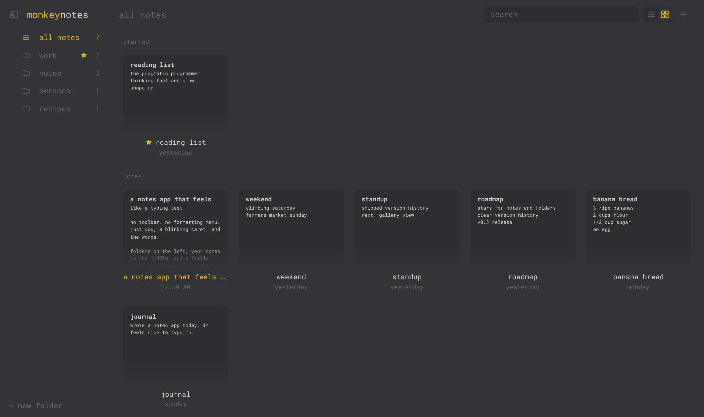

# monkeynotes

A minimal, distraction-free desktop notes app. It's organized simply, like Apple Notes, and writing in it feels like a typing test: monospace text, a smooth blinking caret, and live typing stats.


<p align="center"></p>

## download

No need to build anything. Grab the installer for your computer from the **[latest release](https://github.com/nathanksou/monkeynotes/releases/latest)**:

| your computer | file to download |
| --- | --- |
| Mac with Apple Silicon (M1 or newer) | `monkeynotes_<version>_aarch64.dmg` |
| Mac with an Intel chip | `monkeynotes_<version>_x64.dmg` |
| Windows | `monkeynotes_<version>_x64-setup.exe` (or the `.msi`) |
| Linux | `.AppImage` (runs anywhere), `.deb` (Debian, Ubuntu) or `.rpm` (Fedora) |

The builds aren't signed yet, so your OS will warn you the first time you open the app:

- **macOS**: if it says the app "can't be opened", open **System Settings → Privacy & Security** and click **Open Anyway**. If it says the app "is damaged", run `xattr -cr /Applications/monkeynotes.app` in Terminal once, then open it again.
- **Windows**: on the SmartScreen prompt, click **More info**, then **Run anyway**.

Want to build it yourself instead? See [development](#development).

## features

- **organized like Apple Notes**: a toolbar across the top (sidebar toggle on the left; list/gallery switch, new note, search and settings on the right), a folders sidebar (folders nest up to 8 levels deep), then either a **list view** (notes list next to the editor) or a **gallery view** (a grid of note cards; click one to open it full size, and the back arrow returns to the gallery). The first line of a note is its title, and the list is sorted by last edit, with starred notes on top.
- **typing-test feel**: Roboto Mono and a custom smooth caret. Notes open at the top. If you like, `focus mode` fades the UI while you type (off by default).
- **adjustable sidebars**: drag the folders sidebar's or the notes list's right edge to resize it (double-click the edge to reset).
- **typing stats**: the footer shows live wpm and your average. It stays visible while you type. The chart icon beside it opens a full stats view with words and time typed today, your daily streak and a 14-day chart.
- **typing sounds and animations** (off by default): click, pop, thock or typewriter sounds, synthesized on the fly; letters that float away, sparks, or a caret pulse.
- **`[[links]]`**: Obsidian-style links are underlined. Type `[[` to pick a note from a list. `ctrl+click` a link or press `ctrl+enter` on it to open the note, or create it if it doesn't exist yet. When a note is renamed or moved, links to it are updated.
- **backlinks**: `linked from` in the command line lists every note that links to the open one.
- **`#tags`**: tags get a dotted underline. `ctrl+click` one (or `ctrl+enter`) to search all notes for it, and `tags` in the command line lists them all.
- **command line** (`esc` or `ctrl+k`): every action and setting is a few keystrokes away, including themes with live preview.
- **189 themes**: Monkeytype's whole collection plus a couple of originals, with live preview, and `random theme` when you can't decide.
- **plain markdown files**: every note is a `.md` file in a folder you choose, so you can sync it with iCloud, Dropbox or git, or open it in any other editor.
- **stars**: star notes to keep them at the top of the list and the gallery, and star folders to keep them right below "all notes" in the sidebar.
- **trash**: deleted notes stay in the trash for 30 days; "delete all forever" at the bottom of the trash empties it.
- **version history**: before a note is overwritten, its previous text is kept, at most once every 5 minutes. `version history` in the command line lets you arrow through old versions with a live preview, and restoring one keeps the text it replaces.
- **clear version history**: like clearing browser history. Pick a note, a folder (with its subfolders) or all notes, then a time range (last hour, 24 hours, 7 days, 4 weeks or all time). You see how many versions will go before anything is removed.
- **find in note** (`ctrl+f`): every match is highlighted; `enter` and `shift+enter` step through them.
- **import / export**: bring in `.md` / `.txt` files or a whole folder, and export a single note or everything.
- **local only**: no accounts, no sync service, no telemetry. The only network request is an optional once-a-day check of this repo's public releases, so the app can tell you when there's a new version. Turn it off with `check for updates on launch`.
- **tiny**: built with [Tauri](https://tauri.app), so installers are a few MB instead of 100+.

## keyboard

| keys | action |
| --- | --- |
| `esc` / `ctrl+k` (or the gear) | command line: settings and every action |
| `ctrl+n` | new note |
| `ctrl+shift+n` | new folder |
| `ctrl+p` | jump to note |
| `ctrl+f` | find in note |
| `ctrl+enter` / `ctrl+click` | follow the `[[link]]` under the caret, or search for the `#tag` |
| `[[` | pick a note to link to |
| `ctrl+shift+f` | search all notes (from any folder) |
| `ctrl+\` | show / hide the folders sidebar |
| `ctrl+1` / `ctrl+2` | list view / gallery view |
| `alt+↑` / `alt+↓` (macOS: `cmd+option+↑` / `↓`) | previous / next note |
| `ctrl+=` / `ctrl+-` | font size |

On macOS, use `cmd` wherever `ctrl` is listed. Right-click a note or folder for more actions, and drag notes onto folders to move them.

## where your notes live

Notes are plain markdown files. By default they live in `Documents/monkeynotes`. Use `change notes folder` in the command line to point the app at any folder, such as an existing folder of markdown notes or a synced one.

```
monkeynotes/
  welcome to monkeynotes.md   notes in the default "notes" folder
  ideas/app idea.md           each subfolder is a folder in the app
  .trash/                     the trash (kept for 30 days)
  .monkeynotes.json           pins and trash bookkeeping
  .monkeynotes/history/       older versions of each note (newest 50, up to 90 days)
```

- A note made in the app is named after its first line, and the file is renamed when the title changes. Files you named yourself keep their names. Use `rename note` to pick a file name yourself.
- Prefer file names as titles? Set `note titles` to `file name` in the command line. Files are then never renamed automatically.
- Edits made outside the app show up when you switch back to it.
- Every write goes to a temp file first and is then renamed into place, so a crash can't leave a half-written note.
- monkeynotes never overwrites a file it didn't create. If a note's name is already taken on disk, by a file synced in from elsewhere, say, it picks the next free name (`todo 2.md`).
- If a save fails (for example, the disk is full), your text stays in the app and is retried. It's never replaced by the older copy on disk.
- If your chosen notes folder is missing at launch (an unplugged drive, say), monkeynotes uses the default folder for that session and leaves your choice alone. It doesn't create an empty stand-in folder.

### using an obsidian vault

You can point monkeynotes at an [Obsidian](https://obsidian.md) vault with `change notes folder`. Set `note titles` to `file name` so titles match Obsidian's and files are never renamed, which keeps `[[links]]` working. Notes in Obsidian's `.trash` show up in the trash but are never deleted automatically. Hidden folders such as `.obsidian` are ignored.

App settings (theme, font and so on) are stored separately in the app's data folder (`~/Library/Application Support/com.nathansou.monkeynotes` on macOS, `%APPDATA%\com.nathansou.monkeynotes` on Windows, `~/.local/share/com.nathansou.monkeynotes` on Linux). Notes from v0.1 are moved into the notes folder automatically on first launch.

## development

Want to help? See [CONTRIBUTING.md](CONTRIBUTING.md).

You need [Node 22.12+](https://nodejs.org), [Rust](https://rustup.rs) and the [Tauri system prerequisites](https://v2.tauri.app/start/prerequisites/).

```sh
npm install
npm run app:dev     # run the desktop app with hot reload
npm run app:build   # build an installer for your OS (output: src-tauri/target/release/bundle)
```

`npm test` runs the unit tests (file naming, folders, trash, links, stats), and `cargo test` in `src-tauri` runs the Rust ones.

monkeynotes is desktop-only. For development, `npm run dev` can also serve the UI to a plain browser at http://localhost:1420, with notes kept in a fake file system in localStorage, which is handy for UI work and for driving the UI with Playwright. That code lives in `src/backend-browser.ts` and is left out of release builds; a release build opened in a browser just says it's a desktop app.

### layout

```
src/
  main.ts               app state, rendering, shortcuts, commands
  vault.ts              notes folder in memory, synced to disk (naming, trash, folders)
  backend.ts            disk access (Tauri commands)
  backend-browser.ts    development only: fake notes folder for running the UI in a browser
  errors.ts             error codes shared with the Rust side
  editor.ts             textarea with the custom smooth caret
  paths.ts              helpers for paths inside the notes folder
  paragraphs.ts         per-paragraph layers, so typing stays fast in long notes
  find.ts               find in note
  stats.ts              typing stats (wpm, streaks, daily totals)
  stats-view.ts         the full stats view
  sound.ts              synthesized key sounds
  effects.ts            typing animations
  links.ts              [[link]] and #tag parsing
  updates.ts            new-release check
  palette.ts            command line (menus, previews, prompts)
  model.ts              data types, defaults, helpers
  themes.ts             theme list
  themes-monkeytype.ts  Monkeytype's palettes (generated)
  styles.css
tests/                  vitest unit tests
src-tauri/
  src/lib.rs            file-system commands (scan, atomic write, rename, import/export)
```

### security model

The UI runs in a webview and never sends absolute paths to the Rust side, which owns the notes folder: it's chosen in a native folder dialog and remembered there. Every note path from the UI is relative and checked so it can't leave that folder. Files outside it are only read or written through native open and save dialogs. The webview can't call the dialog or file-system plugins directly, and it can only open links to this repo. All file commands run off the main thread.

### test builds

To get installers without making a release, open the repo's Actions tab, pick **build**, and click **Run workflow**. When it finishes, the macOS, Windows and Linux installers are attached to the run as downloads.

### releases

Push a tag such as `v0.1.0`. The `release` workflow then builds macOS (Apple Silicon and Intel), Windows and Linux installers and attaches them to a draft GitHub release. The builds are unsigned, so macOS Gatekeeper and Windows SmartScreen will warn on first launch.

## roadmap ideas

- find and replace
- custom themes
- markdown preview

## credits

monkeynotes takes its visual inspiration from [Monkeytype](https://github.com/monkeytypegame/monkeytype), the open-source typing test, and shares its license. The theme palettes in `src/themes-monkeytype.ts` come from Monkeytype (GPL-3.0); `scripts/gen-monkeytype-themes.py` regenerates them. monkeynotes is not affiliated with Monkeytype. The font is [Roboto Mono](https://fonts.google.com/specimen/Roboto+Mono), under the SIL Open Font License 1.1. See [THIRD_PARTY_NOTICES.md](THIRD_PARTY_NOTICES.md).

## license

Copyright (C) 2026 Nathan Sou

monkeynotes is free software: you can redistribute it and/or modify it under the terms of the [GNU General Public License](LICENSE), either version 3 or (at your option) any later version. If you distribute a modified version, you must release its source under the same license. The bundled Monkeytype theme palettes are GPL-3.0, so the app as distributed is under GPL-3.0; see [THIRD_PARTY_NOTICES.md](THIRD_PARTY_NOTICES.md).
